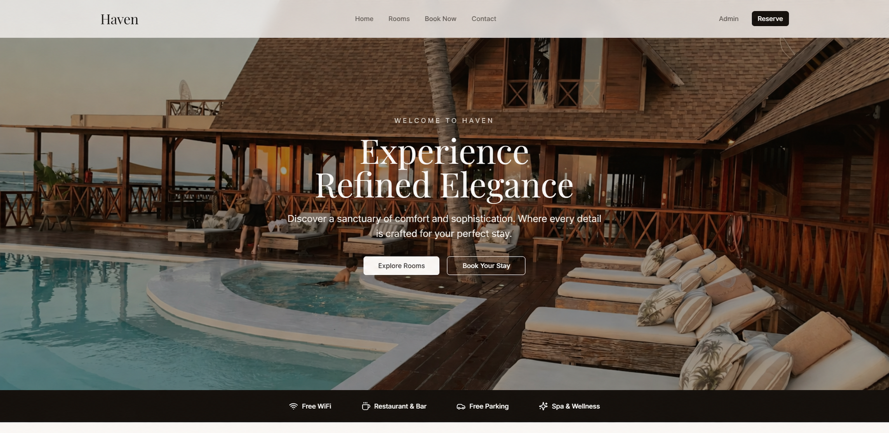

# Hotel Booking - Frontend Application

A responsive hotel booking interface built with Next.js, React, TypeScript, and Tailwind CSS.

This personal portfolio project focuses on modern frontend development, reusable interface components, and the user experience of exploring hotel rooms and navigating a booking flow.

## Live Demo

[View Hotel Booking Application](https://hotel-booking-black-eight.vercel.app/)

## Application Preview



## Overview

The Hotel Booking project explores how a modern accommodation booking interface can be structured and presented across different screen sizes.

The application features a hospitality-inspired design with an immersive homepage, room browsing interfaces, and a booking flow designed to provide a smooth user experience.

## Application Features

- Responsive hotel booking interface
- Modern homepage with a featured hotel experience
- Room listing layouts
- Individual room detail views
- Booking flow interface
- Mobile-friendly layouts
- Component-based frontend architecture

## Tech Stack

| Technology | Purpose |
|------------|---------|
| Next.js | React application framework |
| React | Component-based UI development |
| TypeScript | Type-safe development |
| Tailwind CSS | Styling and responsive layouts |
| Vercel | Application deployment |

## Application Screenshots

The homepage preview is displayed above.

Additional application screenshots can be found in the [`screenshots`](screenshots) directory.

## Getting Started

### Prerequisites

- Node.js
- npm

### 1. Clone the repository

```bash
git clone https://github.com/Dasan-Chamika/hotel-booking.git
```

### 2. Navigate to the project

```bash
cd hotel-booking
```

### 3. Install dependencies

```bash
npm install
```

### 4. Run the development server

```bash
npm run dev
```

### 5. Open the application

Visit [http://localhost:3000](http://localhost:3000) in your browser.

## Project Type

**Personal Portfolio Project**

Developed to demonstrate modern frontend development, responsive layouts, UI component organization, and hotel booking interface design.

This project is presented as a frontend demonstration, not as a production reservation service.

## Developer

**Dasan Chamika**

Frontend & Web Developer

[GitHub](https://github.com/Dasan-Chamika) | [LinkedIn](https://www.linkedin.com/in/dasan-chamika/)
